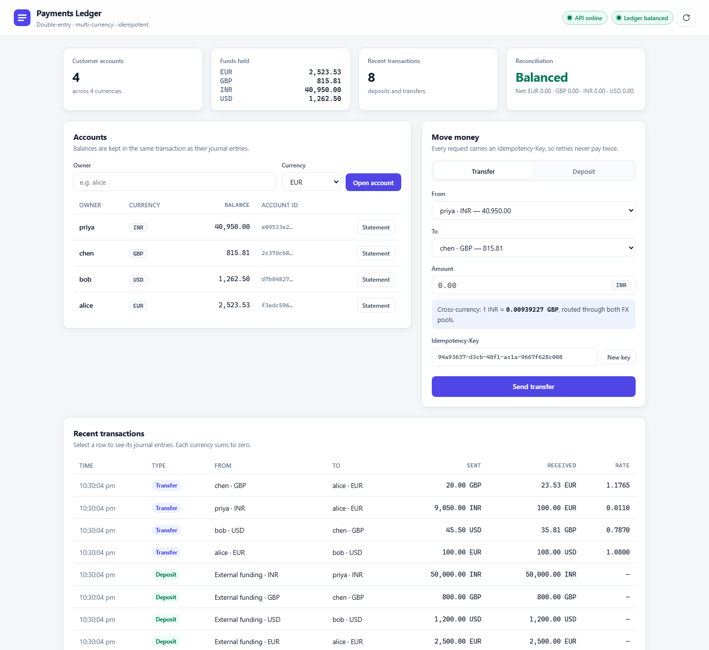
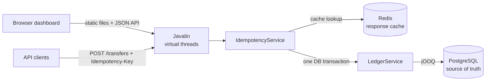

# Payments Ledger

[](https://github.com/SanicaVinayakMyana/payments-ledger/actions/workflows/ci.yml)


A multi-currency, double-entry payments ledger with a web dashboard: the core of a wallet or banking backend.
It moves money between accounts with **no balance drift under concurrency**, **exactly-once retries via
idempotency keys**, and **correct currency handling** (minor units, banker's rounding, FX through treasury pools).

<picture>
  <source media="(prefers-color-scheme: dark)" srcset="docs/images/dashboard-dark.png">
  
</picture>

**Stack:** Java 21 (records, sealed types, virtual threads) · Javalin · jOOQ (code generated from the migrations) ·
PostgreSQL 16 · Flyway · Redis · Spock + Testcontainers · Gatling · Docker · GitHub Actions · GCP Cloud Run

| What is verified | How |
|---|---|
| 10,000 concurrent transfers, zero drift, no deadlocks | [`ConcurrentTransfersSpec`](src/test/groovy/com/sanica/ledger/service/ConcurrentTransfersSpec.groovy): 32 threads, mixed EUR/USD/GBP |
| Retries never move money twice | [`IdempotencyServiceSpec`](src/test/groovy/com/sanica/ledger/idempotency/IdempotencyServiceSpec.groovy): 50 clients race on one key, exactly 1 transfer |
| Throughput and latency | [Gatling results](docs/load-test-results.md): 819 req/s at p95 17 ms / p99 56 ms, 5,316 req/s unpaced |
| 72 tests, 94.2% line coverage | JaCoCo; the build fails below 90% |

## Contents

- [Quick start](#quick-start)
- [Dashboard](#dashboard)
- [Architecture](#architecture)
- [Design decisions](#design-decisions)
- [API](#api)
- [Testing](#testing)
- [Load testing](#load-testing)
- [Deployment](#deployment)
- [Tech stack](#tech-stack)

## Quick start

**Requirement:** JDK 21 (for example [Eclipse Temurin](https://adoptium.net/)). Docker is optional.

```bash
git clone https://github.com/SanicaVinayakMyana/payments-ledger.git
cd payments-ledger
./gradlew runLocal
```

Open **http://localhost:8080**. `runLocal` starts a throwaway PostgreSQL (in Docker if available, otherwise
embedded binaries), runs the migrations and serves the API and the dashboard on port 8080. On Windows, use
`.\gradlew.bat runLocal`. Click **Load demo data** to fill an empty ledger.

**Full stack** with PostgreSQL 16 and Redis 7 in containers:

```bash
docker compose up --build
```

Configuration (environment variables): `PORT` (8080), `DB_URL`, `DB_USER`, `DB_PASSWORD`, `DB_POOL_SIZE` (20),
`REDIS_URL` (optional; without it, idempotency is served from PostgreSQL alone).

## Dashboard

The same server that hosts the API serves the dashboard at `/`. It is plain HTML, CSS and JavaScript in
[`src/main/resources/public`](src/main/resources/public): no build step, no framework, no external CDNs.

- **Accounts:** open accounts in six currencies, see balances, open a statement drawer for any account.
- **Move money:** deposits and transfers. Every request gets an auto-generated `Idempotency-Key`, and
  cross-currency transfers show a live FX preview. **Send again with the same key** demonstrates the replay:
  the response is marked *Replayed · no money moved* and balances do not change.
- **Recent transactions:** select a row to see its double-entry journal. Each currency's lines sum to zero.
- **Status:** API health and the reconciliation result in the header. **Load demo data** appears while the ledger is empty.

Money in the browser is summed in integer minor units (`BigInt`), never floats, like the server. User-supplied text
is inserted as text, never as HTML. Light and dark themes follow the system setting, and the layout works at phone width.

## Architecture



```
src/main/java/com/sanica/ledger
├── Application.java          wiring and lifecycle
├── Config.java               environment-variable configuration
├── api/                      HTTP routes, DTOs, error mapping (thin)
├── service/LedgerService     double-entry rules, locking, FX conversion, reconciliation
├── idempotency/              exactly-once execution, Redis cache (optional)
├── domain/                   records, sealed exception hierarchy, currency rules
├── fx/                       rate provider interface + static reference rates
└── db/                       Hikari pool, Flyway migrations, jOOQ context
src/main/resources
├── db/migration/             V1 schema, V2 insertion-order columns (jOOQ classes are generated from these)
└── public/                   the dashboard: index.html, app.css, app.js
src/test/groovy/              Spock specs and the local dev server (runLocal)
src/gatling/java/             Gatling load-test simulation
docs/                         load-test results, screenshots
```

## Design decisions

### 1. Double-entry bookkeeping
Every money movement creates one `ledger_transactions` row and N `ledger_entries` rows with **signed amounts that
sum to zero per currency**. Money is never created or destroyed. It only moves between accounts:

| Operation | Entries |
|---|---|
| Deposit 100 EUR to Alice | `EXTERNAL:EUR -100` · `Alice +100` |
| Alice (EUR) → Bob (EUR), 40 | `Alice -40` · `Bob +40` |
| Alice (EUR) → Bob (USD), 100 at 1.08 | `Alice -100 EUR` · `FX_POOL:EUR +100 EUR` · `FX_POOL:USD -108 USD` · `Bob +108 USD` |

`GET /admin/reconciliation` checks both invariants: every currency nets to zero across the journal, and every
materialised user balance equals the sum of its entries.

### 2. Concurrency: pessimistic row locks in a global order
A transfer locks both user accounts with `SELECT … FOR NO KEY UPDATE ORDER BY id`, checks the balance,
writes the journal and updates both balances in **one transaction**.

- **No lost updates:** the balance check and the debit happen under the same row lock.
- **No deadlocks:** every transaction acquires locks in the same (id) order, so A→B and B→A cannot wait on each other.
- **`NO KEY UPDATE` rather than `FOR UPDATE`:** other transactions can still insert entries that reference
  the locked rows (foreign-key checks take a compatible `KEY SHARE` lock).
- **Defence in depth:** a `CHECK (kind <> 'USER' OR balance >= 0)` constraint makes overdrafts impossible even if
  application code is bypassed. This is tested.

### 3. Hot system accounts are not materialised
Every deposit touches `EXTERNAL:<ccy>` and every FX transfer touches `FX_POOL:<ccy>`. Locking and updating those
rows would serialise all traffic through a handful of rows. Instead, only user balances are materialised;
system balances are **derived from the journal on read**. System accounts use deterministic ids
(`UUID.nameUUIDFromBytes("FX_POOL:EUR")`), so every instance agrees on them without coordination.

### 4. Idempotency: PostgreSQL is the source of truth, Redis is a cache
```
POST /transfers  Idempotency-Key: k1
  1. Redis GET k1                   → hit: replay stored response (after checking the request hash)
  2. BEGIN
     INSERT idempotency_keys(k1) ON CONFLICT DO NOTHING
        → 0 rows: key exists → replay stored response (or 422 if the payload differs)
        → 1 row:  run the transfer, store the response in the same row
     COMMIT                          ← key and money movement commit or roll back together
  3. Redis SETEX k1 (24h)           ← only after commit; failures are logged, never fatal
```
- **Concurrent duplicates:** a second request with the same key blocks on the first one's uncommitted unique-index
  entry, then sees the conflict and replays. Tested with 50 racing clients.
- **Failed requests don't consume the key:** an insufficient-funds rollback removes the key row too, so the client
  can top up and retry with the same key.
- **Key reuse with a different body** (detected by a SHA-256 hash of method, path and body) returns `422`.
- **A Redis outage** degrades to a cache miss. Payments keep working. Tested.

### 5. Money handling
- `BigDecimal` everywhere, `NUMERIC(19,4)` in the database, amounts serialised as **strings** in JSON.
- Amounts are validated against the currency's minor unit (`10.001 EUR` and `1.5 JPY` are rejected, never rounded).
- FX conversion rounds **half-even** to the destination's minor unit; a conversion that would round to zero is rejected.
- Rates live behind `FxRateProvider`; the static EUR-based table is a stand-in for a live feed.

### 6. Ordering
Entries, accounts and transactions carry a `GENERATED ALWAYS AS IDENTITY` sequence (`seq`). Every
"newest first" list is ordered by it, not by timestamp: wall-clock timestamps collide and aren't monotonic. The test
suite caught this twice on Windows, where the clock is coarse. Indexes on `seq` (and `(account_id, seq DESC)` for
statements) serve "latest N" as a single backward index scan. The columns on accounts and transactions were added by
a second Flyway migration, `V2__insertion_order.sql`, rather than by editing V1.

## API

| Method | Path | Notes |
|---|---|---|
| `GET` | `/` | the dashboard |
| `GET` | `/accounts?limit=50` | user accounts, newest first, 1–200 |
| `POST` | `/accounts` | `{"ownerId":"alice","currency":"EUR"}` → 201 |
| `GET` | `/accounts/{id}` | balance as a string at currency scale |
| `GET` | `/accounts/{id}/entries?limit=50` | newest first, 1–200 |
| `POST` | `/deposits` | **requires `Idempotency-Key`** · `{"accountId":"…","amount":"500.00"}` |
| `POST` | `/transfers` | **requires `Idempotency-Key`** · `{"fromAccountId":"…","toAccountId":"…","amount":"100.00"}` |
| `GET` | `/transactions?limit=50` | latest transactions with their entries (one query for all entries, not one per row) |
| `GET` | `/transactions/{id}` | transaction with its journal entries |
| `GET` | `/fx/rate?from=EUR&to=USD` | |
| `GET` | `/admin/reconciliation` | ledger invariants |
| `GET` | `/health` | |

Replays return the original body with the header `Idempotent-Replayed: true`.
Errors are `{"error":"CODE","message":"…"}`: `400 VALIDATION_ERROR`, `404 NOT_FOUND`, `422 INSUFFICIENT_FUNDS`,
`422 IDEMPOTENCY_KEY_REUSED`.

```bash
curl -s -X POST localhost:8080/accounts -H 'Content-Type: application/json' -d '{"ownerId":"alice","currency":"EUR"}'
curl -s -X POST localhost:8080/accounts -H 'Content-Type: application/json' -d '{"ownerId":"bob","currency":"USD"}'
curl -s -X POST localhost:8080/deposits  -H 'Content-Type: application/json' -H 'Idempotency-Key: dep-1' \
     -d '{"accountId":"<alice-id>","amount":"500.00"}'
curl -s -X POST localhost:8080/transfers -H 'Content-Type: application/json' -H 'Idempotency-Key: tr-1' \
     -d '{"fromAccountId":"<alice-id>","toAccountId":"<bob-id>","amount":"100.00"}'
```

## Testing

```bash
./gradlew build      # generate jOOQ classes, compile, run all specs, enforce the 90% coverage gate
```

72 tests. Specs run against **real PostgreSQL**: Testcontainers in CI, embedded PostgreSQL locally if Docker is
absent. The Redis integration spec runs wherever Docker is available (it is skipped otherwise). Reports:
`build/reports/tests/test` and `build/reports/jacoco/test/html`.

| Spec | Focus |
|---|---|
| `LedgerServiceSpec` | double-entry rules, FX routing and rounding, validation, DB-level overdraft guard, reconciliation |
| `ConcurrentTransfersSpec` | 10,000 concurrent mixed-currency transfers: zero drift, no overdrafts, no deadlocks |
| `IdempotencyServiceSpec` | replay, payload mismatch, failed-request retry, 50-way race, cache-after-commit |
| `LedgerApiSpec` | end-to-end HTTP flow, status codes, error contract, list endpoints, the dashboard page |
| `CurrenciesSpec`, `StaticFxRateProviderSpec`, `ConfigSpec` | minor-unit rules, cross rates, configuration |
| `RedisResponseCacheSpec`, `RedisOutageSpec` | cache round trip; graceful degradation when Redis is down |

## Load testing

```bash
./gradlew runLocal                                                    # terminal 1
./gradlew gatlingRun --simulation ledger.TransferSimulation \
    -Dusers=50 -DtargetRps=1000 -DdurationSeconds=60                  # terminal 2
```

`-DtargetRps=0` removes pacing to measure maximum throughput. The measured results (819 req/s at p95 17 ms and
p99 56 ms paced; 5,316 req/s unpaced; zero failed requests), the environment and the caveats are in
[docs/load-test-results.md](docs/load-test-results.md).

## Deployment

`docker build .` produces a non-root JRE 21 image that honours Cloud Run's `PORT`. CI
([`ci.yml`](.github/workflows/ci.yml)) builds, tests and builds the image on every push.

The manual [`deploy.yml`](.github/workflows/deploy.yml) workflow builds, pushes to Artifact Registry and deploys
to Cloud Run with Cloud SQL and Secret Manager, using Workload Identity Federation (no long-lived keys). It needs a
GCP project and the repository settings listed at the top of that file. **Status:** the workflow is ready but has not
been run yet.

## Tech stack

| Area | Choice | Why |
|---|---|---|
| Language | Java 21 | records, sealed types, pattern matching, virtual threads |
| HTTP | Javalin 6 | small, explicit SparkJava-style routing; serves the dashboard too |
| SQL | jOOQ 3.19 | type-safe SQL with full control over locks; classes generated from the migrations |
| Database | PostgreSQL 16 | ACID, row locks, `NUMERIC`, `ON CONFLICT`, CHECK constraints |
| Migrations | Flyway 10 | versioned schema, same on every environment |
| Pool | HikariCP 5 | fixed-size connection pool |
| Cache | Redis 7 (Jedis) | optional idempotency response cache, fail-open |
| Tests | Spock 2.3, Testcontainers, embedded PostgreSQL, JaCoCo | readable specs against a real database, coverage gate |
| Load | Gatling 3.12 | paced and unpaced HTTP load |
| Delivery | Gradle 8.10, Docker, GitHub Actions, Cloud Run | reproducible builds, CI, container deploy |

## Possible extensions

- Authentication and per-user authorisation
- Outbox table + event publishing (Pub/Sub/Kafka) for downstream consumers such as fraud scoring
- Live FX rates with quote expiry, and spread/fees booked to a revenue account
- Holds/authorisations (two-phase transfers) for card payments
- Partitioning `ledger_entries` by time; periodic balance snapshots for very large accounts
- Metrics and tracing (Micrometer, OpenTelemetry)

## License

[MIT](LICENSE)
